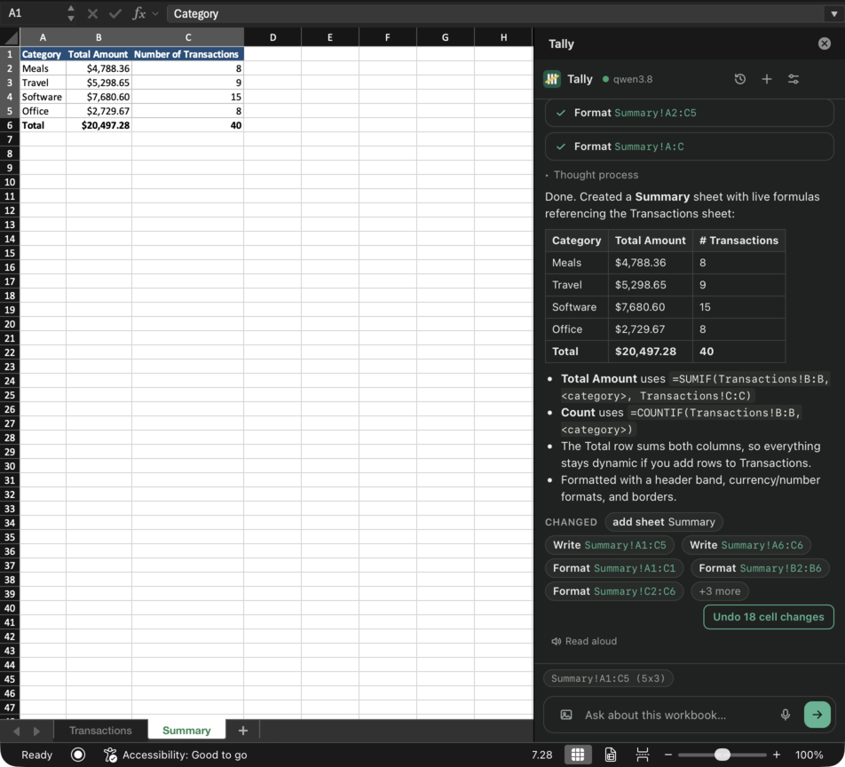

<p align="center"></p>

# Tally

**A private AI agent for Microsoft Excel on Mac.** Tally sits in a side panel, reads your workbook, writes live formulas, builds tables and charts, cleans data and fixes its own errors. It runs entirely on your Mac with a local model through [Ollama](https://ollama.com), so your workbook never leaves your computer.

Every change Tally makes is listed with its cell address, can be selected with one click, and can be undone. It asks before it clears cells or runs code, and if a change fails it says so above its reply.

<p align="center"></p>

## Requirements

- A Mac with **Apple silicon** (M1 or later) and **32 GB of memory or more**. The default model, `qwen3.8` (27B, 4-bit), takes about 17 GB.
- **Microsoft Excel for Mac** (Microsoft 365).
- [Homebrew](https://brew.sh).
- About 20 GB of free disk space.

## Install

```bash
curl -fsSL https://raw.githubusercontent.com/joserbo97/tally-excel/main/install.sh | bash
```

The installer checks your Mac first, then:

1. installs the tools it needs with Homebrew (Node.js, Poppler for PDFs, and Ollama if you don't have it);
2. downloads the `qwen3.8` model (about 17 GB);
3. downloads Tally to `~/tally-excel`;
4. trusts a certificate for `https://localhost`, which Office requires (macOS asks for your password once);
5. adds Tally to Excel;
6. starts Tally's small local server, and again at every login.

Then **quit Excel completely and open it again**. **Tally** appears at the right end of the Home tab. If it doesn't, go to Insert → Add-ins → My Add-ins → Developer Add-ins.

Options: `bash -s -- --check` only checks your Mac and changes nothing; `--with-dictation` also sets up local voice dictation (about 600 MB more). Running the installer again updates Tally and skips anything already done. To install somewhere else, set `TALLY_DIR`; to try another Ollama model with tool support, set `TALLY_MODEL`.

Prefer to do it by hand? Clone this repository and run `./install.sh` from it, or follow the steps in [Manual setup](#manual-setup).

## Update and uninstall

```bash
~/tally-excel/install.sh          # update to the latest version
~/tally-excel/uninstall.sh        # remove Tally from Excel and stop its server
```

The uninstaller leaves Ollama and the model in place (`ollama rm qwen3.8` removes the model) and says how to remove the certificate and the folder.

## Privacy

- The model runs in Ollama on your Mac. Your workbook, attachments and chats stay on this computer.
- The only things that can go online are web searches and the pages Tally opens when a task needs outside facts (exchange rates, public statistics). Turn web access off in settings and those tools are removed.
- Tally's server listens on `localhost` only and accepts requests only from its own panel.

## Manual setup

```bash
git clone https://github.com/joserbo97/tally-excel.git && cd tally-excel
brew install node poppler ollama     # skip ollama if you use the Ollama app
ollama pull qwen3.8
npm ci
npx office-addin-dev-certs install --days 365   # trusts a localhost certificate
npm run sideload                                  # adds Tally to Excel
npm run install-service                           # runs the server now and at login
```

Or run the server in a terminal instead of at login: `npm start` (it serves the panel at `https://localhost:3443`). The service's log is `~/Library/Logs/Tally/server.log`. After editing `server.js`, restart it with `launchctl kickstart -k gui/$(id -u)/local.tally`. Changes under `public/` only need the panel reloaded (Office's "i" menu → Reload).

## Web search and page reading

The agent can look things up online when a task needs outside facts: exchange rates, prices, public statistics, company figures.

- **`web_search`** uses DuckDuckGo (no account or API key) and returns titles, links and snippets.
- **`web_fetch`** reads a public page as text, keeping tables as rows. Long pages are read in chunks.

**PDFs** (annual reports, central-bank bulletins, statistical tables) are read with Poppler (`brew install poppler`), which keeps table columns aligned as `|`-separated rows:
- Text is marked `=== Page N of M ===`. The agent reads the table of contents, then jumps straight to a page with `page=N`.
- Downloaded PDFs (up to 40 MB) are cached for 20 minutes, so moving between pages is instant.
- **Scanned PDFs** have no text layer, so the page is rendered as an image and read with qwen3.8's vision. The agent can also ask to *see* any page (`as_image`), which helps with charts and complex layouts. Rendered pages show as thumbnails in the step card.
- Offline checks: `node scripts/test-pdf.mjs <scanned.pdf> <text.pdf>`

Each search and page visit appears as a card in the panel showing the query, or the site with a clickable link. When the agent writes a web figure into the sheet, it also writes the source URL and date next to it.

**Privacy and safety:**
- Only search queries and the pages it opens go online, never your workbook. The agent is instructed not to put cell contents into a query or URL.
- Fetched pages are marked as untrusted, so the agent ignores any instructions hidden in them.
- The server refuses to open local or private addresses: localhost, Ollama, your router and other devices on your network, cloud metadata addresses, including disguised forms like `0x7f.1` or `[::ffff:127.0.0.1]`. This is checked again on every redirect.
- Turn web access off in settings ("Allow web search & page reading") and the tools are removed entirely.

## Screenshots and images (vision)

`qwen3.8` can see images. To attach up to 4 per message:
- **Paste:** press ⌃⇧⌘4 to copy a screen region to the clipboard, click the message box, and press ⌘V.
- **Drag and drop** image files onto the panel.
- **Click the image button** to the left of the message box.

Things to try:
- "Put this table into the sheet starting at A1": transcribes a screenshot, PDF table, or photo of a receipt into cells.
- "Recreate this chart from my data"
- "What does this error mean?" with a screenshot of an Excel error or formula.
- "Check whether this invoice adds up."

Images are scaled down to 1600px on the long side, sent only to your local Ollama, and kept for the current session only. After you reload the panel, the transcript shows a placeholder where the image was. If you switch to a model without vision, the panel warns you.

## Attaching PowerPoint presentations

`.pptx` (also `.ppsx`/`.pptm`) and `.odp` attach like other files and show as orange chips (slides · charts). They're read directly from the file, with nothing to install:

- **Slides** come in presentation order as `=== Slide N of M: title ===`, with bullets (and indent levels), text boxes, tables as `| rows |`, and **speaker notes**. Slide numbers, dates and footers are skipped.
- **Charts** come with their **underlying data**, read from the numbers the chart stores, as `[Chart: title (type)]` tables. The agent can put a chart's data into a sheet and rebuild the chart. A `[percent]` series stores fractions (0.34 = 34%).
- **Pictures** are marked `[Picture: alt text]`. Their contents can't be seen, because this Mac has no slide renderer (no LibreOffice), so the agent says so rather than guessing.
- Long decks: the agent gets the list of slide titles and jumps to a slide with `page=N`.
- Old `.ppt` and Keynote `.key` files get a clear message asking you to save or export them as `.pptx`.
- `web_fetch` reads `.pptx` files linked from web pages too.
- Offline checks: `node scripts/test-slides.mjs [decks…]`

Try: attach a budget deck and say "Put the chart on slide 5 into a new sheet with totals and recreate it."

## Attaching Excel files and other spreadsheets

`.xlsx`, `.xlsm`, `.xlsb`, `.xls`, `.ods`, `.csv` and `.tsv` attach the same way as other files and show as green chips (sheets · rows). They're read locally with SheetJS.

- **Reading:** the agent sees each sheet as `| row | A | B | … |`, with real Excel addresses and formulas in `⟨=…⟩`, so it can say "the total in Sales!C4 is…". Huge declared ranges are trimmed to the cells actually used.
- **Importing:** the `import_from_file` tool copies data exactly, without passing it through the model:
  - *copy_sheet* inserts a whole sheet as a new tab with Excel's own sheet insert. For `.xlsx`/`.xlsm`, formatting, column widths and formulas are preserved. Other formats are converted first (values and formulas only).
  - *values* writes a sheet or range into a target location, in chunks, keeping number formats (%, currency, dates). Use `include_formulas` to copy formulas instead of results. "Undo cell changes" covers imports up to 50,000 cells, and anything up to 300,000 cells can be imported.
- **From the web:** a spreadsheet the agent opens with `web_fetch` (for example a census or central-bank `.xlsx`) is registered the same way, so it can be imported too.
- Offline checks: `node scripts/test-sheets.mjs`

Try: attach last month's export and say "Copy the Transactions sheet in, then add a pivot-style summary by category next to it."

## Attaching PDFs and Word documents

**Word documents** (`.docx`, `.doc`, `.rtf`, `.odt`) work like PDFs and show as blue chips with a word count. `.docx` files are read directly, so headings (`#`), bullet lists (`-`) and tables (`| a | b |`) come through intact, and text deleted under Track Changes is skipped. `.doc`, `.rtf` and `.odt` go through macOS's built-in `textutil`, which also keeps tables. For long documents, the agent gets an outline of headings and jumps straight to the section it needs. `web_fetch` reads Word files linked from web pages too. Offline checks: `node scripts/test-word.mjs [files…]`

Attach **PDFs** the same way as images, up to 3 documents per message: drag them onto the panel, click the attach button, or paste a copied file. Each PDF is read on your Mac right away (with Poppler, `brew install poppler`), and the chip shows its page count. Nothing is uploaded anywhere.

- **Small PDFs** (about 8,000 characters or less) go straight into the message, so the agent answers without an extra step.
- **Larger PDFs** are read with the `read_document` tool. The agent reads the contents page, jumps to the pages it needs, and can look at any page as an image (charts, scans).
- **Scanned PDFs** are read visually, page by page.
- When figures go into the sheet, the agent notes the document name and page, keeps the units ("dollars in millions"), and turns bracketed negatives like (1,234) into real negative numbers.
- Attached PDFs stay available for 6 hours, or until the add-in server restarts. After that, the agent asks you to attach the PDF again.

Try: drop in an annual report and ask "Put the income statement for the last 3 years into a new sheet", or attach a bank statement and ask "Categorize these transactions".

## Dictation (speech-to-text)

Click the 🎤 button next to Send, speak, then click it again. Your speech is transcribed **locally** by whisper.cpp (Whisper large-v3-turbo, running on the Apple GPU) and inserted into the message box, so you can review it before sending. Esc cancels a recording. In settings you can pick the dictation language (auto-detect works well for English and Spanish) or turn on "Send automatically after dictation".

One-time setup:

```bash
brew install whisper-cpp
npm run stt-model        # ~550 MB model into ./models
```

The first time you dictate, macOS asks whether **Microsoft Excel** may use the microphone; allow it. You can change this later in System Settings → Privacy & Security → Microphone.

Test it without a microphone:

```bash
say -o /tmp/t.wav --data-format=LEF32@48000 "add a total row"
NODE_EXTRA_CA_CERTS=~/.office-addin-dev-certs/ca.crt node scripts/test-stt.mjs /tmp/t.wav
```

## Read aloud (text-to-speech)

Every reply has a **Read aloud** button. Click it again (or press Esc) to stop. The voice comes from macOS's built-in offline voices (via `say`), so nothing is sent anywhere. Tables and code blocks aren't read cell by cell; the voice says "the table is in the panel" instead. Cell ranges are spoken naturally ("Sheet1, A1 to F6").

In settings:
- **Read replies aloud automatically.** Together with "Send automatically after dictation", this gives you a hands-free voice conversation.
- **Voice.** "Auto" picks Samantha for English replies and Paulina for Spanish ones, or you can choose any installed voice.
- **Speech rate**, in words per minute.

Speech stops automatically when you send a new message or start dictating, so the microphone never hears the agent.

For much more natural voices, download an *Enhanced* or *Premium* voice in System Settings → Accessibility → Spoken Content → System Voice → Manage Voices. "Auto" prefers these automatically once they're installed.

## What the agent can do

| Tool | Purpose |
|---|---|
| `get_workbook_info` | sheets, used ranges, tables, names, selection |
| `read_range` | values + formulas (raw or as displayed), auto-clipped to the used range |
| `write_range` | write a 2D block of values/formulas; returns computed results + any `#ERRORS` |
| `format_range` | fonts, fills, number formats, borders, alignment, widths, merge, autofit |
| `manage_sheet` | add / rename / copy / delete / activate sheets |
| `insert_delete_cells` | insert/delete rows, columns or blocks |
| `create_table`, `create_chart`, `sort_range` | Excel tables, charts, sorting |
| `find_cells`, `select_range` | search the workbook; navigate the user to a range |
| `execute_office_js` | escape hatch: arbitrary Office.js (conditional formatting, validation, freeze panes…) |

Every message automatically includes your active sheet, selection, and used range, so "this", "these cells" and "the selection" work as expected.

## Settings (sliders icon)

- **Model**: any Ollama model with tool support (default `qwen3.8:latest`)
- **Thinking**: Off / Low / Medium / High. Low is a good balance; Off is fastest.
- **Context window**: 32K by default. Raise it for big workbooks or long chats.
- **Ask before**: by default the panel asks before deleting, clearing, or running custom code. Set it to "Any change" for full review, or "Never" for full auto.
- **Max tool steps** per message (default 30).

## Chats per workbook

Each workbook has its own chats. The first time you chat in a workbook, the panel stores a hidden ID *inside the file* (an add-in setting), so the chat follows the file even if you rename or move it. Opening the panel alone doesn't change the workbook.

- **+ (New chat)** starts a fresh chat; the previous one is kept.
- **History (clock icon)** lists this workbook's chats, newest first. Click one to switch to it, or click Delete twice to remove it. Up to 30 chats are kept per workbook.
- If browser storage fills up (about 5 MB), the oldest chats from *other* workbooks are dropped first.
- **Older conversation:** if you used the panel before this feature, your old conversation is offered on the empty screen ("Move it to this workbook") and in History, until you move it into the workbook you choose.
- A copy made with Save As shares the original's chats, since it carries the same ID. New chats go to whichever copy you're working in.
- Chats are stored on this Mac (in the panel's browser storage), not in the file, so they don't travel with the workbook to another computer.

**Undo cell changes** appears under any turn that wrote values. It restores the previous values and formulas. Formatting, charts and tables are not undone.

## Security and offline use

- The local server only accepts browser requests from the add-in's own page (Origin check) and only on `localhost`/`127.0.0.1`/`[::1]` (Host check, which blocks DNS rebinding). Other websites you visit can't make it speak, upload files, or reach Ollama through the proxy. Command-line clients without an Origin header (curl, the test scripts) still work.
- Oversized request bodies get a `413` error instead of hanging.
- Office.js is served locally from the `@microsoft/office-js` npm package, so the panel works with no internet. The server log says `Office.js served locally …` the first time it's loaded. If the local copy is ever missing, the panel falls back to Microsoft's CDN.

## How it works

```
Excel task pane (public/)  ──HTTPS──>  server.js  ──>  Ollama :11434 (/api/chat, streaming, tools)
        │
        └── Office.js Excel API  (tools.js)
```

`server.js` serves the panel and proxies `/ollama/*` to Ollama, which avoids CORS and mixed-content problems. It listens on loopback only. The agent loop (`public/js/agent.js`) streams the model's thinking and text, runs tool calls, feeds back the results, and repeats until the model answers.

## Benchmark: how good is the agent?

`npm run bench` runs 27 realistic Excel tasks against the real model and the agent's real tools, on an in-memory workbook that behaves like Excel. Formulas are evaluated with HyperFormula, typed input is parsed like Excel, and sorting moves formula references. Each result is scored automatically.

| Category | What it tests |
|---|---|
| analysis | answering questions from the data without changing it (top region, category averages, finding and explaining #DIV/0!/#N/A) |
| formulas | totals, growth %, lookups across sheets, SUMIFS/COUNTIFS summaries, tiered commission with exact boundaries |
| fix | repairing #DIV/0!, a SUM range missing a row, typed-in totals (and saying which one was wrong) |
| cleanup | splitting names, text→numbers, removing duplicates, sorting, standardizing categories |
| modeling | loan calculator (PMT), 3-year projection with input cells, break-even |
| visual | table + chart, professional formatting with frozen header |
| files | importing an attached CSV, a PDF invoice, chart data from a PowerPoint slide, a table from a Word memo |
| multi-sheet | a quarterly sheet totalling three monthly sheets |

**Live-formula checks:** whenever a task builds something, the scorer changes an input cell (for example the interest rate) and checks that the output follows. Typed-in numbers fail; live formulas pass. Answers are found by meaning (a "Total" label, a "Growth" header), so any sensible layout scores the same.

**Hard tier** (`npm run bench:hard`, 7 tasks): a full 180-row amortization schedule that must reach a balance of 0 and stay correct when the rate changes; a 6-month × category grid from 200 transactions, including dates on month boundaries; a ledger-vs-bank reconciliation with 4 planted discrepancies and no false ones; NPV/IRR, where Excel's NPV-discounts-year-0 trap must be avoided; a scenario model driven by a 1/2/3 selector cell; a top-3 question over 3,000 rows (too big to read directly); and a messy bank export with dates stored as text and decimal-comma amounts ("Bs 1.234,50"). Use `--suite all` to run both tiers.

**The checks are tested too:** `npm run bench:selftest` does two things. First, it checks that 22 common Excel formulas give Excel's answers in the scoring engine. HyperFormula differs from Excel on bare `TRUE`/`FALSE`, single-row `INDEX(range, n)` and `TEXT()` formats, and the mock translates those, so valid Excel isn't scored as an error. Second, it applies a known-correct solution to every task through the same tools; all of them must pass. Untouched workbooks fail every task.

Options: `--tasks formulas,fix` (categories or task ids), `--repeat 3` (run each task several times to measure consistency), `--model <tag>`, `--think off|low|medium|xhigh`, `--ctx 65536`. Results go to `bench-results/` (JSON with every check, tool call and answer, plus a Markdown summary; `latest.md` is always the newest). A formula using an Excel function HyperFormula doesn't support (TEXTBEFORE, LET, AVERAGEIFS…) is marked ❔ *unverifiable*, not failed. Web search is off during benchmark runs, so results don't depend on live websites.

## Testing without Excel

```bash
npm run test:agent                       # default scenario
node scripts/test-agent.mjs "your prompt" # custom prompt
```

This runs the real agent loop against your local model, using an in-memory mock workbook. Formulas are evaluated by HyperFormula.

## Troubleshooting

- **Panel is blank or shows a certificate error**: run `npm run certs` again (the certificate lasts 365 days), then restart Excel.
- **"Ollama offline"** in the header: open the Ollama app (or `brew services start ollama`), and check the server log at `~/Library/Logs/Tally/server.log`.
- **Button missing**: run `npm run sideload` again, then fully quit Excel (⌘Q) and reopen it.
- **Start over**: `./uninstall.sh`, then `./install.sh`.
- **Clear Office's add-in cache**: `rm -rf ~/Library/Containers/com.microsoft.Excel/Data/Library/Caches/*` while Excel is closed.

## License

MIT. See [LICENSE](LICENSE). Tally is an independent project and isn't affiliated with Microsoft, Ollama or the makers of the Qwen models.
